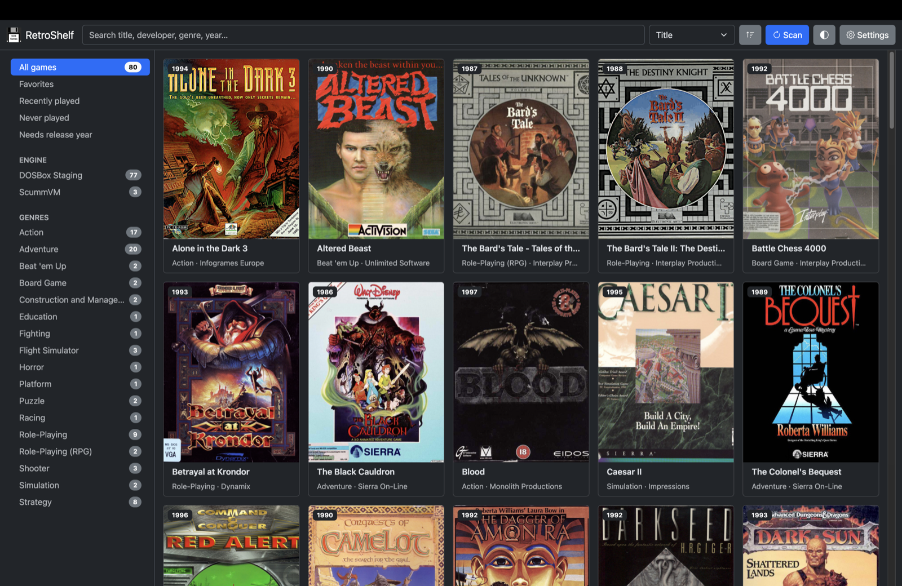
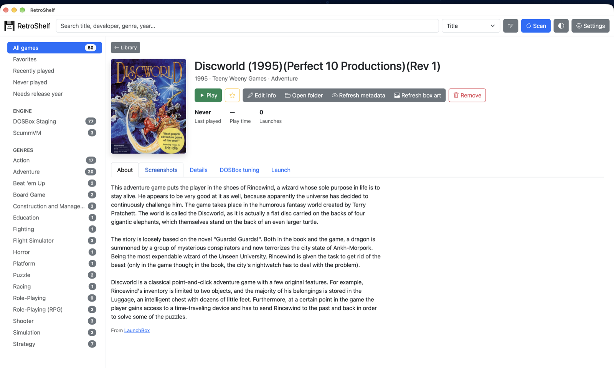
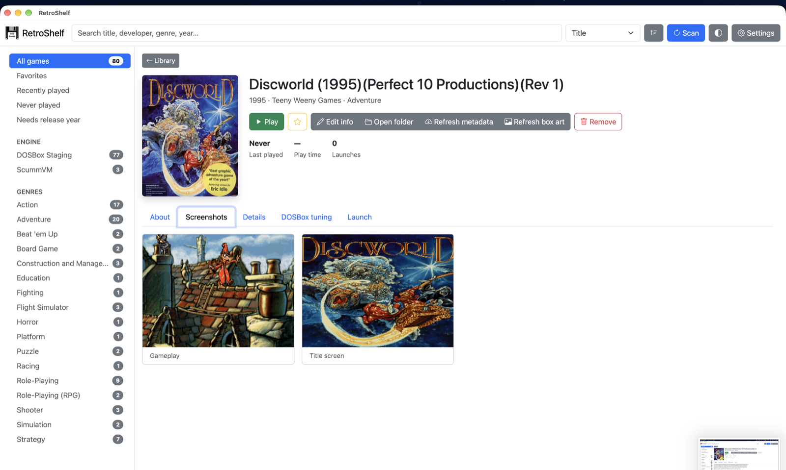
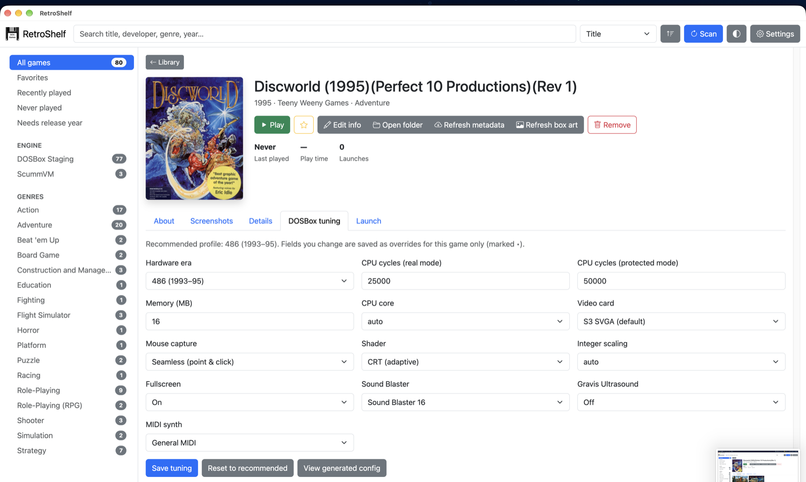

# RetroShelf

<p align="center">
  
</p>

<p align="center">
  <strong>A local-first library and launcher for the DOS and SCUMM games you already own.</strong><br>
  DOSBox Staging and ScummVM, per-game configs, and a shelf that looks like it belongs in this century.
</p>

RetroShelf is a desktop library and launcher for DOS and SCUMM games you already own. It turns a folder of game installs into a browsable shelf with box art, screenshots, metadata, play time, and a Play button. It does not sell, download, or bundle games.

Point RetroShelf at the folders where your games live. It scans them, matches each folder against a curated DOS catalog, and decides whether the game should run in DOSBox Staging or ScummVM. For DOSBox games it generates a per-game config from an era profile covering CPU, memory, video, sound, MIDI, shader, and scaling, then lets you override any field. Metadata and artwork come from MobyGames, Wikipedia, LaunchBox, libretro, and the Internet Archive; everything is cached locally. Launching is one click, and play time is tracked automatically.

The hard part of retro gaming is not finding the games. It is getting each one to run. DOSBox configs are a pile of cycles, memory, sound, and mount settings that change from title to title. RetroShelf puts that knowledge into a curated catalog and a readable tuning panel instead of another wiki page.

It uses the emulators people already trust, keeps your games and library data on your machine, and writes plain DOSBox Staging configs and readable JSON. There is no account, no telemetry, and no lock-in. The project is MIT-licensed and ships with tests covering scanning, config generation, metadata parsing, game matching, and store behavior. The library screenshot above is a real 80-game collection.

```sh
npm run build
```

That installs dependencies, runs the tests, and packages the app for your platform. You need Node.js 22.17 or newer, DOSBox Staging and/or ScummVM, and a folder of games. The ask is simple: try it on your own collection, report the game that did not launch cleanly, or send the game profile that made it work. Every profile makes the next person’s first launch quieter.

## Screenshots

<p align="center">
  
  
</p>

<p align="center">
  <em>Game details, screenshots, and the controls you need before you hit Play.</em>
</p>

<p align="center">
  
</p>

<p align="center">
  <em>DOSBox tuning: an era-aware profile plus per-game overrides for the stubborn titles.</em>
</p>

## Installation

### Requirements

- Node.js 22.17 or newer
- DOSBox Staging and/or ScummVM
- A folder of DOS or SCUMM games you already own
- A MobyGames API key is optional; lookups that need it are skipped without one

### Build and run

Clone the repository (or download and extract the ZIP), then run the build from its folder:

```sh
git clone https://github.com/velkymx/retroshelf.git
cd retroshelf
npm run build
```

`npm run build` installs dependencies if needed, runs the test suite, and packages the app for your current platform. It prints the finished app path at the end. The output lives under `out/RetroShelf-<platform>-<arch>/`:

- macOS: `out/RetroShelf-darwin-arm64/RetroShelf.app`
- Windows: `out/RetroShelf-win32-x64/RetroShelf.exe`
- Linux: `out/RetroShelf-linux-x64/RetroShelf`

Open the app, then:

1. Open **Settings** and point RetroShelf at DOSBox Staging and/or ScummVM.
2. Add the folders that contain your games.
3. Click **Scan**.
4. Pick a game and press **Play**.

RetroShelf keeps its library, configs, captures, downloaded media, and logs in a `RetroShelf-data` folder next to the app, or next to the source checkout when running from source.

### Development

```sh
npm install
npm start
```

Run the test suite directly with `npm test`. Build a packaged app without the test step with `npm run package`. Create platform installers with `npm run make`.

## License

MIT
